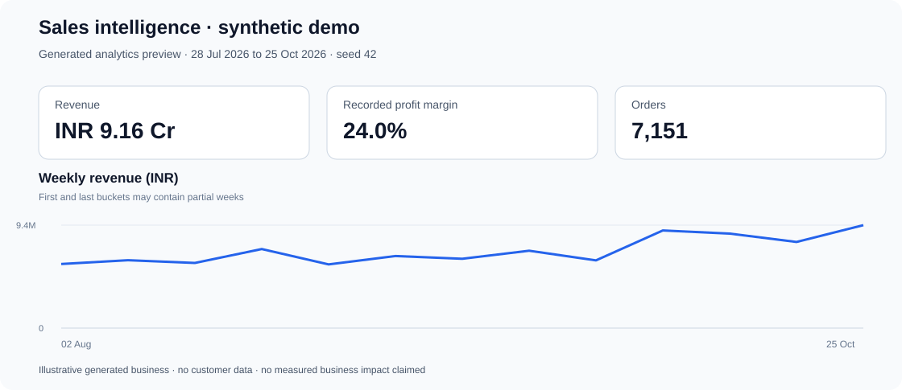
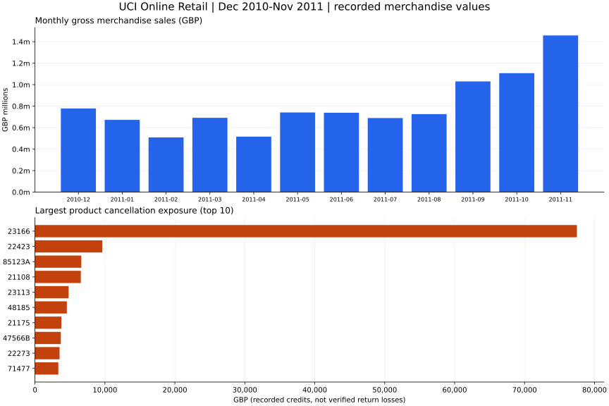

# Sales Intelligence Dashboard

A local-first sales analytics app for deciding **where to investigate revenue changes, margin pressure, and unusual trading periods**. Built with Python, Streamlit, pandas, statsmodels, and scikit-learn.

The planned real-data SQL addition is defined in the [PRD](docs/PRD.md), [scope](docs/SCOPE.md), and [phased task checklist](docs/TASKS.md). Each implementation phase must pass its documented checks before the next begins. [Phase 0 baseline verification](docs/evidence/phase-0.md) has passed; [Phase 1 source profiling](docs/evidence/phase-1.md) has also passed; [Phase 2 database preparation](docs/evidence/phase-2.md) has passed; [Phase 3 SQL reconciliation](docs/evidence/phase-3.md) has passed; [Phase 4 UI verification](docs/evidence/phase-4.md) has passed, including user visual review; [Phase 5 report verification](docs/evidence/phase-5.md) has passed; [Phase 6 release verification](docs/evidence/phase-6.md) passed, including local full-data checks and both Python 3.11/3.12 GitHub Actions jobs. See [reproduction instructions](docs/release-readiness.md).

**Start with the [real-data SQL case study](docs/sql-case-study.md)** for historical UCI retail analysis: inspectable SQL, independently reconciled findings, preparation judgments and proposed investigations. The [synthetic case study](docs/case-study.md) remains a separate demonstration. Neither claims client work or realised business impact. No API key is required.





## What a reviewer can inspect

- **Decision brief:** regional revenue movements, negative-profit line exposure, and discounted/full-price margin comparisons. Each finding includes evidence, an investigation, and a caveat; the brief can be downloaded.
- **Forecast evaluation:** chronological three-month validation against a seasonal-naive or last-month baseline. Holt-Winters is selected only if its MAE is lower; both predictions and errors are visible.
- **Auditable preparation:** standard sales and Superstore CSV imports validate data and expose cleaning steps. Invalid uploads stop with an error instead of silently showing demo results.
- **Local demo:** generated sales, decision findings, forecasting, and anomaly screening run without credentials or network calls. Expensive tabs compute only when opened.
- **Optional AI:** Groq, Gemini, and Anthropic adapters can rewrite aggregates and answer questions scoped to the active dates. External generation requires an explicit toggle and action.

In the fixed synthetic case, selected-period revenue is INR 91.61 million and recorded margin is 23.96%. Forecast validation WAPE is 4.13% for Holt-Winters versus 18.68% for seasonal naive. These validation months select the model; they are **not an independent test estimate**. See the case study for exact dates, arithmetic, findings, and limitations.

## Run locally

Use Python 3.10-3.13. From this repository's root:

```powershell
python -m venv .venv
.\.venv\Scripts\Activate.ps1
python -m pip install -r requirements.txt
python -m streamlit run app.py
```

On macOS/Linux, activate with `source .venv/bin/activate`. Open http://localhost:8501. If PowerShell blocks activation, run `.\.venv\Scripts\python.exe -m streamlit run app.py` after installing dependencies with that same interpreter.

Select **Generated sample**, leave **Use online AI** off, and inspect Overview, Forecast, and Data & EDA. The default window is the last 90 days in the dataset, not the computer's current date. Stop with Ctrl+C.

### Real-data SQL view

With the accepted local database prepared, select **Real-data SQL (GBP)** in the sidebar. Choose inclusive retail dates and a country; the view exposes complete-month trends, cancellation exposure, concentration, and repeat purchasing. Quality/provenance and accepted SQL are expandable. Downloads contain scoped aggregates, with customer rankings and purchase sequences excluded.

```powershell
python scripts/prepare_online_retail.py
python -m streamlit run app.py
```

If the raw workbook is absent, use the documented Phase 1 download/profile command first and review any source-hash change before preparation. This view uses historical 2010-2011 GBP data, runs locally without AI, and estimates no profit or causal effect. Phase 4 automated checks and user visual review have passed. See [Phase 4 evidence](docs/evidence/phase-4.md).

For development:

```powershell
python -m pip install -r requirements-dev.txt
python -m pytest
python scripts/build_case_study.py
python scripts/build_sql_case_study.py
```

The synthetic command regenerates its seed-42 artifacts. The SQL report command uses the accepted local database to regenerate the historical report, aggregate JSON, SVG and PNG charts, and reruns its independent reconciliation. Report plotting requires the development dependencies. Both reports omit generation timestamps and are deterministic within the recorded dependency environment. Dependencies are version-bounded, not fully locked; scientific optimisation can produce small numerical differences across versions.

## Data and interpretation

| Source | Scope | Preparation |
| --- | --- | --- |
| Generated sample | Synthetic Indian D2C history, 2023-01-01 through 2026-10-25 | Seeded growth, festive seasonality, weekend uplift, promotions, and injected unusual days |
| Superstore CSV | User-supplied Tableau/Kaggle-style exports | Dates, duplicates, missing labels, numeric validity, discount units, and losses are audited; ship mode is a channel proxy |
| Own CSV | Columns listed below | Parses dates and numerics; audits dropped rows and missing dimension labels; checks ranges, IDs, finite values, and profit reconciliation |

Own CSV columns:

```text
date,order_id,region,city,category,product,channel,customer_segment,units,discount,revenue,cost
```

`profit` is optional and derived as `revenue - cost` when absent. Supplied profit must be numeric and reconcile within 0.02. Units must be positive whole numbers, revenue positive, and cost nonnegative. Discounts accept consistent fractions (0-1) or percentages (0-100); mixed scales are rejected. Use ISO dates (`YYYY-MM-DD`) for custom data. Missing descriptive labels become `Unknown`; missing order IDs are rejected. See the in-app report for row removals and assumptions.

Custom data currently represents positive sales, not a returns ledger. Recorded profit reflects only costs included in the input; it is not necessarily net profit. For Superstore, reported profit is retained, including losses and anomalies flagged in the report. No third-party dataset is distributed. Confirm the source licence before sharing uploaded files; `data/*.csv` is ignored by Git.

## Methods and engineering choices

See [method notes](docs/methods.md) for evaluation, thresholds, assumptions, and failure behaviour.

- Adjacent equal-length periods describe change; missing comparison coverage suppresses growth claims. They do not control for seasonality.
- Forecasts use all available history under dimension filters, independently of the selected dates. The final incomplete month is excluded using a documented coverage heuristic.
- The last three usable months are validation data. MAE selects the method; WAPE handles individual zero-sales months. With fewer than nine usable months, a baseline is shown without a validation score. Approximate bands are not calibrated probability intervals.
- Isolation Forest is retrospective screening. The 40% deviation rule is a materiality heuristic; sensitivity controls the outlier fraction. Flags need investigation and do not establish causes.
- Discount comparisons are associations. The app does not estimate causal promotion uplift or promise recoverable savings.

## Optional online AI

Groq is the primary documented online path; the core demo does not depend on it. Create a key in the [Groq console](https://console.groq.com/keys), enable **Use online AI**, select **Groq**, and enter the key in the sidebar. **Check connection** authenticates a metadata request; successful generation also depends on model access, quota, and provider availability.

For a deployment, create `.streamlit/secrets.toml` using the commented example and add only the provider you use:

```toml
GROQ_API_KEY = "your-key"
# Optional; otherwise the app uses its default and model-aware fallback:
# GROQ_MODEL = "openai/gpt-oss-20b"
```

Environment variables with the same names are also supported. Other adapters use `GEMINI_API_KEY` / `GEMINI_MODEL` and `ANTHROPIC_API_KEY` / `ANTHROPIC_MODEL`. Deployment keys stay server-side and are not prefilled in browser inputs. User-entered keys remain in that browser session's password widget. Never commit secrets.

A separate opt-in live smoke check sends only a small hard-coded synthetic aggregate and prints a sanitised outcome. It requires the provider key in the environment and may use provider quota:

```powershell
python scripts/check_provider.py --provider groq
```

Offline tests mock provider calls; passing them does not prove that a particular key works today. No live credentials or remote deployment are required for CI.

If a request fails, local summaries remain available. Missing SDKs require installing `requirements.txt` in the interpreter running Streamlit. Model errors trigger supported-model fallback where implemented; quota or authentication failures do not trigger model hopping. For continued errors, use local mode and check the provider console.

Only aggregates are sent, but grouped labels and business metrics may still be sensitive. No authentication or minimum-group-size privacy guarantee is provided. Do not upload confidential or regulated data to a public instance. This is a portfolio application, not an authenticated internal analytics platform.

## Verification and deployment

Tests cover generator edge cases, validation and cleaning, forecast baselines and leakage, business finding arithmetic, provider contracts, partial streaming failures, and Streamlit navigation/upload flows. CI runs tests and a dependency audit on Python 3.11 and 3.12.

For a demo deployment, use `app.py` as the entry point and install `requirements.txt`. Start with generated data and no keys. A public demo URL is not included because this repository has not been deployed as part of this work.

```text
app.py                       Streamlit interface
sales_ai/data.py              Generator and standard-schema validation
sales_ai/cleaning.py          Superstore preparation and audit
sales_ai/decisions.py         Evidence, action, and caveat findings
sales_ai/ai.py                Forecast evaluation, anomalies, and provider adapters
scripts/build_case_study.py   Reproduce the portfolio evidence
scripts/check_provider.py     Opt-in live provider smoke check
scripts/build_sql_case_study.py Real-data report and charts from accepted SQL
docs/                        Case study, preview, and method notes
tests/                       Analytical, UI, and provider regression coverage
```
