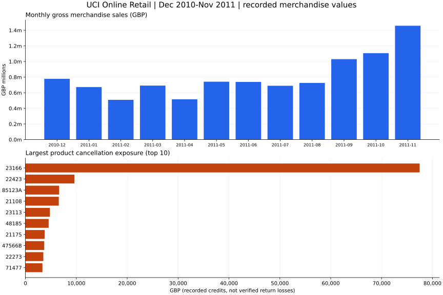

# Real-data case study: where should a retailer investigate first?

An independent portfolio investigation of **historical UCI Online Retail transactions**, not a client engagement, current-company assessment or measured business improvement.

## Business question and fixed scope

Where should the retailer investigate sales variation, cancellation exposure and dependence on identified repeat purchasers before making operational or customer-activity decisions?

- Selection: **1 December 2010 through 30 November 2011 inclusive**, all countries; SQL start `2010-12-01`, exclusive end `2011-12-01`.
- December 2011 is incomplete and excluded. The first 12 observed months are provisionally complete, not proof of an uninterrupted export.
- Source workbook SHA-256: `43465a06f2ccf7c8b5bd2892bc7defb52f97487934fe93b16ae4c3936424676d`; preparation policy/schema 1.0; source-local naive dates; GBP.
- Exact thousandths of GBP are retained; final displays use decimal half-even penny rounding.

## Headline recorded values

| Metric | Selected window |
| --- | ---: |
| Gross merchandise sales | GBP 9,655,939.79 |
| Cancellation exposure | GBP 304,597.42 |
| Recorded net merchandise value | GBP 9,351,342.37 |
| Distinct sales invoices | 18,957 |

Gross minus cancellation exposure is not profit or audited net revenue; other adjustments/nonmerchandise records are excluded by the contract. Trace figures through [aggregate evidence](sql-case-study.json), [exposure SQL](../sql/online_retail/20_stock_code_exposure.sql), and [scope summary SQL](../sql/online_retail/40_repeat.sql).

## Three findings and proposed investigations

### 1. Monthly Peak

**Evidence:** 2011-11 has the largest complete-month gross merchandise sales: GBP 1,457,745.53, across 2,751 sales invoices.

**Proposed action:** Investigate product/country mix and operational capacity before using this month as a stock-planning benchmark.

**Limit:** One observed annual cycle cannot establish seasonality, promotion effectiveness, stock shortages or the cause of the peak.

[Inspect SQL](../sql/online_retail/10_monthly.sql)
### 2. Cancellation Exposure

**Evidence:** Product 23166 has the largest cancellation exposure: GBP 77,479.64; gross sales are GBP 81,448.21. Its same-window cancellation-to-sales ratio is 95.1%.

**Proposed action:** Review invoice/cancellation records and fulfilment history before deciding whether a process investigation is warranted.

**Limit:** Credits are not matched to original sales and may relate to earlier purchases. This is not a verified return rate or recoverable-savings estimate.

[Inspect SQL](../sql/online_retail/20_stock_code_exposure.sql)
### 3. Identified Repeat

**Evidence:** 2,742 of 4,293 identified purchasers bought on at least two distinct invoices (63.9%). Identified customers cover 85.4% of gross sales. The top 10 identified customer groups contribute 16.7% of identified-customer gross sales.

**Proposed action:** Check customer-ID coverage and concentration before proposing a retention pilot; define a control group and predeclared outcome before measuring an intervention.

**Limit:** Within-window repeat purchasing is not lifetime retention. Missing IDs are excluded from customer denominators. No intervention or commercial uplift has been measured.

[Inspect SQL](../sql/online_retail/40_repeat.sql) · [Supporting SQL](../sql/online_retail/30_customer_id_concentration.sql)

## Computed charts and source table



This is a generated chart, not an application screenshot. Product exposure shows 10 of 3918 groups; 3908 omitted groups remain in JSON. Customer identities and individual purchase sequences are not published.

| Complete month | Gross merchandise sales | Cancellation value | Distinct sales invoices |
| --- | ---: | ---: | ---: |
| 2010-12 | GBP 777,931.77 | GBP 17,607.86 | 1,550 |
| 2011-01 | GBP 671,933.19 | GBP 91,526.30 | 1,081 |
| 2011-02 | GBP 508,886.20 | GBP 8,375.87 | 1,093 |
| 2011-03 | GBP 691,257.61 | GBP 10,675.30 | 1,440 |
| 2011-04 | GBP 516,218.12 | GBP 33,316.91 | 1,235 |
| 2011-05 | GBP 741,192.41 | GBP 8,948.23 | 1,668 |
| 2011-06 | GBP 738,751.87 | GBP 13,760.84 | 1,525 |
| 2011-07 | GBP 689,364.41 | GBP 11,409.21 | 1,452 |
| 2011-08 | GBP 725,513.50 | GBP 22,929.52 | 1,339 |
| 2011-09 | GBP 1,030,475.36 | GBP 17,044.68 | 1,818 |
| 2011-10 | GBP 1,106,669.82 | GBP 43,992.16 | 2,005 |
| 2011-11 | GBP 1,457,745.53 | GBP 25,010.54 | 2,751 |

## Preparation judgments and population impact

The following counts cover the **entire 541,909-row workbook**, including December 2011, not just this report's window. Every row remains in staging.

- Eligible sales lines: 527,758; eligible cancellation lines: 8,704.
- Excluded lines: 5,445; quarantined lines: 2. Mutually exclusive dispositions sum to 541,909.
- 135,080 missing customer IDs remain nullable: eligible monetary values remain, but customer denominators exclude them. Selected-window coverage is disclosed above.
- 1,454 missing descriptions do not invalidate otherwise eligible product-code records.
- 5,268 duplicate-looking excess rows are flagged and retained, not assumed erroneous. Excluding them in the SQLite sensitivity view changes the whole-workbook, all-disposition signed bridge by GBP 21,740.98. This is not a gross-merchandise-sales effect or confirmed correction; the retained policy remains primary.
- Negative prices are quarantined. Zero-value records, known nonmerchandise codes and unmatched negative adjustments are separately excluded. Nonstandard code syntax alone does not establish invalid merchandise.
- Source prices have up to three decimal places; rounding every line to pennies could alter the financial bridge and is not performed.

See [treatment rules](retail-data-contract.md), [profile](evidence/phase-1/profile.json), [preparation bridge](evidence/phase-2/quality.json), and [query catalogue](sql-query-catalogue.md). Flags overlap and must not be added as row removals.

## Validation and limits

Generation reruns the independent Python oracle for exactly the same scope before writing files. All seven queries reconcile, even though customer rankings and purchase sequences are not exported. Report figures, chart inputs and narrative come from those accepted results, avoiding hand-entered totals.

Monthly changes require adjacent complete calendar months and a nonzero prior base. Cancellation ratios are not matched-sale return rates and may exceed 100%. Concentration denominators include the full eligible population, including chart omissions. Repeated lines do not imply repeat purchases. Product labels are codes, without future-looking descriptions.

No costs, profit, causal effects, cancellation reasons, verified sale-credit links or intervention outcomes are available. Findings justify investigations, not automatic budget changes. A future pilot needs a predeclared outcome, comparison/control strategy and operational guardrails. No stakeholder approval or pilot result is claimed. Aggregation/removing identifiers does not establish anonymisation.

## Reproduce and inspect

```powershell
python scripts/prepare_online_retail.py
python scripts/verify_retail_sql.py
python scripts/build_sql_case_study.py
python -m pytest
```

To inspect the same selection in the app, choose **Real-data SQL (GBP)**, dates **2010-12-01 through 2011-11-30**, and **All countries**. The app default includes partial December 2011, so its default totals differ.

If the local workbook is absent, follow [source instructions](retail-provenance.md) first and review changed hashes. Report/JSON/SVG omit timestamps so their content is deterministic; environment/hash evidence is separate. The [synthetic case](case-study.md) is a separate demonstration, not part of these real-data results.

## Attribution

Chen, D. (2015). Online Retail [Dataset]. UCI Machine Learning Repository. https://doi.org/10.24432/C5BW33. [Official source](https://archive.ics.uci.edu/dataset/352/online+retail), [CC BY 4.0](https://creativecommons.org/licenses/by/4.0/). This project classifies, aggregates and charts the data; its creator has not endorsed this analysis.
